<!-- Header -->

  

  

  
  
  
  

 

Most models are trained once and quietly decay. I work on the part after the notebook: pipelines that catch drift, agents with real guardrails, and data systems that hold up when the inputs get messy. I care about tests, CI and honest evaluation as much as the model itself.

- 🎓 **B.Tech CSE (AI/ML)** at OUTR Bhubaneswar, 2024–2028
- 💼 **AI/ML Intern** at iplairani, Jun–Aug 2026
- 🎯 **Looking for** AI/ML engineering or data science internships, summer 2027
- 🌱 Preparing for **GSoC 2027** · 200+ LeetCode problems solved

 

## 🛠️ Things I've built

  
  
  
  
  
  

  <a href="https://tourscout-lovat.vercel.app"><b>TourScout live</b></a> ·
  <a href="https://vulngraph-oit9.onrender.com"><b>VulnGraph live</b></a> ·
  <a href="https://lexrag-kn8r.onrender.com/"><b>LexRAG live</b></a> ·
  <a href="https://sql-data-analytics-project.vercel.app/"><b>Warehouse dashboard</b></a>

<b>More projects</b>

 

| Project | What it does | Stack |
|---|---|---|
| **[LexRAG](https://lexrag-kn8r.onrender.com/)** | Cited question answering over Indian law (Constitution, BNS, BNSS, BSA) | FastAPI · LangGraph · pgvector · Groq |
| **[SQL Data Warehouse](https://github.com/anurag-23werty/sql-data-warehouse-project)** | CRM + ERP exports through bronze, silver and gold layers into a star schema | PostgreSQL · PL/pgSQL · Python |
| **[CoLift](https://github.com/anurag-23werty/CoLift_Model)** | Uplift modeling: who should actually get the discount? | Python · causal ML |
| **[AvaSensor](https://github.com/anurag-23werty/AvaSensor)** | Catches soft faults in aircraft sensors before they become hard faults | Python · time series |
| **[AI Agent Eval System](https://github.com/anurag-23werty/AI-agent-eval-system)** | A harness for evaluating LLM agents | Python |

 

## 🔭 On the bench

- **AdaptML** — a production model that retrains itself when its data or performance drifts, with an agent deciding *when* to retrain instead of a fixed threshold
- **OpsDesk** — a backend and system-design project: a travel-ops ticketing platform in FastAPI
- **[ShorGul Bench](https://github.com/anurag-23werty/ShorGul)** — a benchmark for speech recognition on noisy telephony audio

 

## 🧰 Tech stack

<table>
  <tr>
    <td><b>Languages & data</b></td>
    <td></td>
  </tr>
  <tr>
    <td><b>ML</b></td>
    <td>
       
      
      
      
      
      
    </td>
  </tr>
  <tr>
    <td><b>LLMs & agents</b></td>
    <td>
      
      
      
      
      
      
    </td>
  </tr>
  <tr>
    <td><b>Shipping it</b></td>
    <td></td>
  </tr>
</table>

 

## 📫 Get in touch

Hiring for an AI/ML or data role, or building something with agents or MLOps? [Message me on LinkedIn](https://www.linkedin.com/in/anurag-choudhury-ai) or [send an email](mailto:anurag.omm11@gmail.com).

  

