<picture>
  <source media="(prefers-color-scheme: dark)" srcset="assets/svg/hero-dark.svg" />
  
</picture>

 

Most models are trained once and quietly decay. I'm interested in the part after the notebook: pipelines that catch drift, agents that do real work, and data systems that hold up when the inputs get messy. I study AI/ML at OUTR Bhubaneswar, spent summer 2026 as an ML intern at iplairani, and I'm looking for AI/ML engineering or data science internships for summer 2027.

[LinkedIn](https://www.linkedin.com/in/anurag-choudhury-63a780206/) &nbsp;&nbsp; [Email](mailto:24110387@outr.ac.in) &nbsp;&nbsp; [FastFrame on PyPI](https://pypi.org/project/fastframe-pandas/)

 

<picture>
  <source media="(prefers-color-scheme: dark)" srcset="assets/svg/h-built-dark.svg" />
  
</picture>

**[FastFrame](https://github.com/anurag-23werty/FastFrame)** 
Finds slow pandas and NumPy code, rewrites only the patterns it can prove are safe, and checks the output still matches. Up to 332× faster. Install it with `pip install fastframe-pandas`. 
LibCST, pandas, NumPy, Docker

**[VulnGraph](https://github.com/anurag-23werty/VulnGraph)** 
A vulnerability triage agent that ranks CVEs by the attack paths that actually reach your assets, not by CVSS score alone. [Try the live demo](https://vulngraph-oit9.onrender.com). 
LangGraph, FalkorDB, FastMCP, Groq

**[SatPred](https://github.com/anurag-23werty/SatPred)** 
Early anomaly detection on NASA SMAP and MSL satellite telemetry. Every alert names the channel that failed and when it started. 
PyTorch, scikit-learn, FastAPI

**[SQLYapper](https://github.com/anurag-23werty/SQLYapper)** 
Ask a SQL database questions in plain English. The agent reads the schema, plans the query, runs it and explains the answer. 
LangGraph, Groq, SQL

**[SQL Data Warehouse](https://github.com/anurag-23werty/sql-data-warehouse-project)** 
CRM and ERP exports cleaned through bronze, silver and gold layers into a star schema, with a [live analytics dashboard](https://sql-data-analytics-project.vercel.app/) on top. 
PostgreSQL, PL/pgSQL, Python

 

<picture>
  <source media="(prefers-color-scheme: dark)" srcset="assets/svg/h-bench-dark.svg" />
  
</picture>

**AdaptML** is the idea in the banner, made real: a production model that retrains itself when its data or performance drifts, with an agent deciding *when* to retrain instead of a fixed threshold.

Alongside it, a multimodal pipeline that checks insurance claims against their photos, and a few hackathon builds in sports analytics and agentic AI.

 

<picture>
  <source media="(prefers-color-scheme: dark)" srcset="assets/svg/h-tools-dark.svg" />
  
</picture>

**Every day:** Python, SQL, pandas, NumPy, scikit-learn, PyTorch 
**Agents and LLMs:** LangChain, LangGraph, Hugging Face, RAG, MCP 
**Shipping it:** FastAPI, Docker, GitHub Actions, PostgreSQL, Linux, Render

 

<picture>
  <source media="(prefers-color-scheme: dark)" srcset="assets/svg/h-contact-dark.svg" />
  
</picture>

Hiring for an AI/ML or data role, or building something with agents or MLOps? [Message me on LinkedIn](https://www.linkedin.com/in/anurag-choudhury-63a780206/) or [send an email](mailto:24110387@outr.ac.in).
